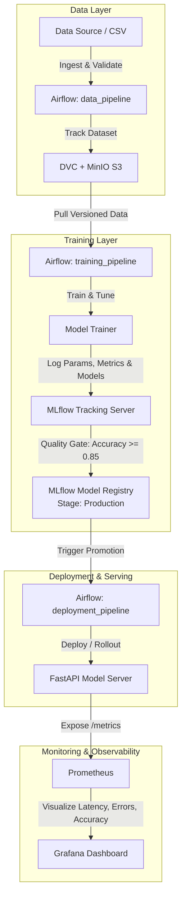

# Project 102: End-to-End MLOps Pipeline Review

**Location:** `C:\repos\ai-infra-engineer-learning\projects\project-102-mlops-pipeline`  
**Purpose:** Concise end-to-end walkthrough of the architecture, components, data flow, and current state.

---

## 1. What is This Project?

This project builds an automated, production-grade **MLOps (Machine Learning Operations) platform** that replaces manual notebook workflows with an end-to-end automated lifecycle:
```
Raw Data ➔ Ingestion & Validation ➔ DVC Versioning ➔ Training & Evaluation ➔ MLflow Registry ➔ Automated Deployment ➔ Model Serving ➔ Prometheus/Grafana Monitoring
```

**Core Mission:** Automate data validation, experiment tracking, model evaluation gating, zero-downtime serving, and real-time observability.

---

## 2. End-to-End System Architecture



---

## 3. Technology Stack & Responsibilities

| Layer | Tool / Technology | Role in Pipeline |
| :--- | :--- | :--- |
| **Orchestration** | **Apache Airflow 2.8.0** | Schedules and runs data, training, and deployment DAGs. |
| **Experiment Tracking** | **MLflow 2.10.0** | Logs runs, hyperparams, training metrics, and model artifacts. |
| **Model Registry** | **MLflow Registry** | Manages versioning and stage transitions (`Staging` ➔ `Production`). |
| **Data Versioning** | **DVC** | Tracks dataset versions and connects to remote storage. |
| **Object Store** | **MinIO (S3-compatible)** | Stores MLflow artifacts, datasets, and models. |
| **Database** | **PostgreSQL 15** | Central metadata store for Airflow and MLflow. |
| **Message Broker** | **Redis 7** | Optional broker for Celery executor / caching. |
| **Inference Serving** | **FastAPI + Uvicorn** | Serves HTTP prediction requests (`/predict`) and health checks (`/health`). |
| **Container & Cloud** | **Docker Compose / K8s** | Docker Compose for local dev; Kubernetes manifests for production. |
| **Monitoring** | **Prometheus + Grafana** | Prometheus scrapes inference latency/errors; Grafana displays dashboards. |

---

## 4. Repository Structure & Key Files

```
project-102-mlops-pipeline/
├── docker-compose.yml       # Local 9-service infrastructure stack
├── Dockerfile.airflow       # Airflow image with pipeline dependencies
├── init-db.sql              # Database initializer (creates airflow and mlflow DBs)
├── requirements.txt         # Core dependencies
│
├── dags/                    # Airflow workflow definitions
│   ├── data_pipeline.py       # Ingest, validate, preprocess, version data
│   ├── training_pipeline.py   # Load data, train, evaluate, register best model
│   └── deployment_pipeline.py # Model pull, container build, rollout, health check
│
├── src/                     # Core business logic modules
│   ├── data/                  # Ingestion (CSV/DB), preprocessing, validation
│   ├── training/              # Model training (sklearn), evaluation, tuning
│   ├── deployment/            # Model deployment and serving endpoints
│   └── monitoring/            # Health checks and Prometheus custom metrics
│
├── monitoring/              # Observability configs
│   ├── prometheus/prometheus.yml                   # Scrape targets
│   └── grafana/provisioning/dashboards/mlops-*.json # Pre-built dashboards
│
├── kubernetes/              # Production deployment manifests
│   ├── model-deployment.yaml  # Deployment, HPA, and PDB definitions
│   ├── service.yaml           # Service & Ingress rules
│   └── configmap.yaml         # Serving config
│
├── tests/                   # Pytest unit tests (data, training, deployment)
│
└── planning/                # Implementation planning and tracking
    ├── REMEDIATION_PLAN.md    # Fixes for infrastructure & stub gaps
    └── TRACKER.md             # Task board and milestone progression
```

---

## 5. How the Pipeline Works: 3 Primary Workflows

### 1. Data Pipeline (`dags/data_pipeline.py`)
- **Schedule:** Scheduled (e.g. daily at 2 AM).
- **Execution:**
  1. `ingest_raw_data`: Pulls source data into `data/raw/`.
  2. `validate_data_quality`: Runs schema checks, null thresholds, and range boundaries.
  3. `preprocess_data`: Imputes missing values, encodes categories, scales features, and splits to `train`/`val`/`test`.
  4. `version_data_dvc`: Hashes and tracks processed data with DVC.

### 2. Training Pipeline (`dags/training_pipeline.py`)
- **Schedule:** Triggered after data pipeline completes (e.g. 4 AM).
- **Execution:**
  1. `load_data`: Pulls versioned data.
  2. `train_model`: Fits model (e.g., Random Forest) and logs params/metrics to MLflow.
  3. `evaluate_model`: Evaluates on validation set (Accuracy, F1-score).
  4. `decide_promotion`: Branches: if metrics $\ge$ threshold (e.g. 85%), promotes model to `Production` in MLflow Registry; otherwise skips.
  5. `trigger_deployment`: Triggers `deployment_pipeline` if promoted.

### 3. Deployment & Serving Pipeline (`dags/deployment_pipeline.py`)
- **Trigger:** Automatic upon model promotion.
- **Execution:**
  1. `pull_model`: Downloads the `Production` model artifact from MLflow/MinIO.
  2. `build_docker_image`: Packages model into serving container.
  3. `deploy_to_k8s` / `docker-compose`: Executes rolling update.
  4. `perform_health_checks`: Tests `/health` and `/predict` endpoints.
  5. `rollback_deployment`: Reverts to previous version if probes fail.

---

## 6. Current Implementation State

| Area | Current State | What's Needed to Run Locally |
| :--- | :--- | :--- |
| **Infrastructure** | `docker-compose.yml` configures Postgres, Redis, MinIO, MLflow, Airflow, Prometheus, Grafana. | Add MinIO bucket auto-creation (`mlflow-artifacts`), active `.env`, and add model server container. |
| **Python Code (`src/`)** | Skeleton stubs with `NotImplementedError`. | Implement concrete CSV ingestion, preprocessing, scikit-learn training, and FastAPI server. |
| **Airflow DAGs** | Use inline dummy arrays (`[[1,2]]`). | Wire tasks to call `src/` modules. |
| **Tests** | All tests skipped with `self.skipTest`. | Implement assertions in `tests/test_*.py`. |

---

## 7. Next Steps & Reference Documents

- **Step-by-step local deployment guide:** [LOCAL_DEPLOYMENT_REVIEW_AND_PLAN.md](LOCAL_DEPLOYMENT_REVIEW_AND_PLAN.md)
- **Remediation plan for all code & config gaps:** [REMEDIATION_PLAN.md](planning/REMEDIATION_PLAN.md)
- **Task board and milestone tracker:** [TRACKER.md](planning/TRACKER.md)
